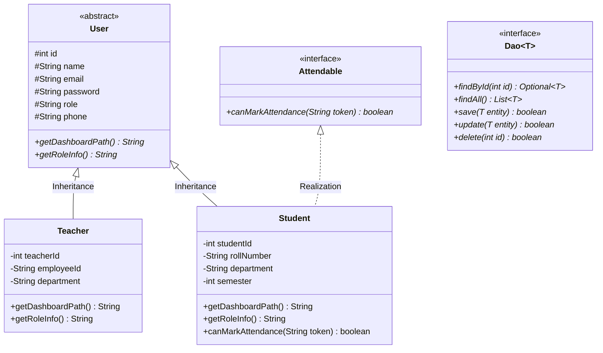
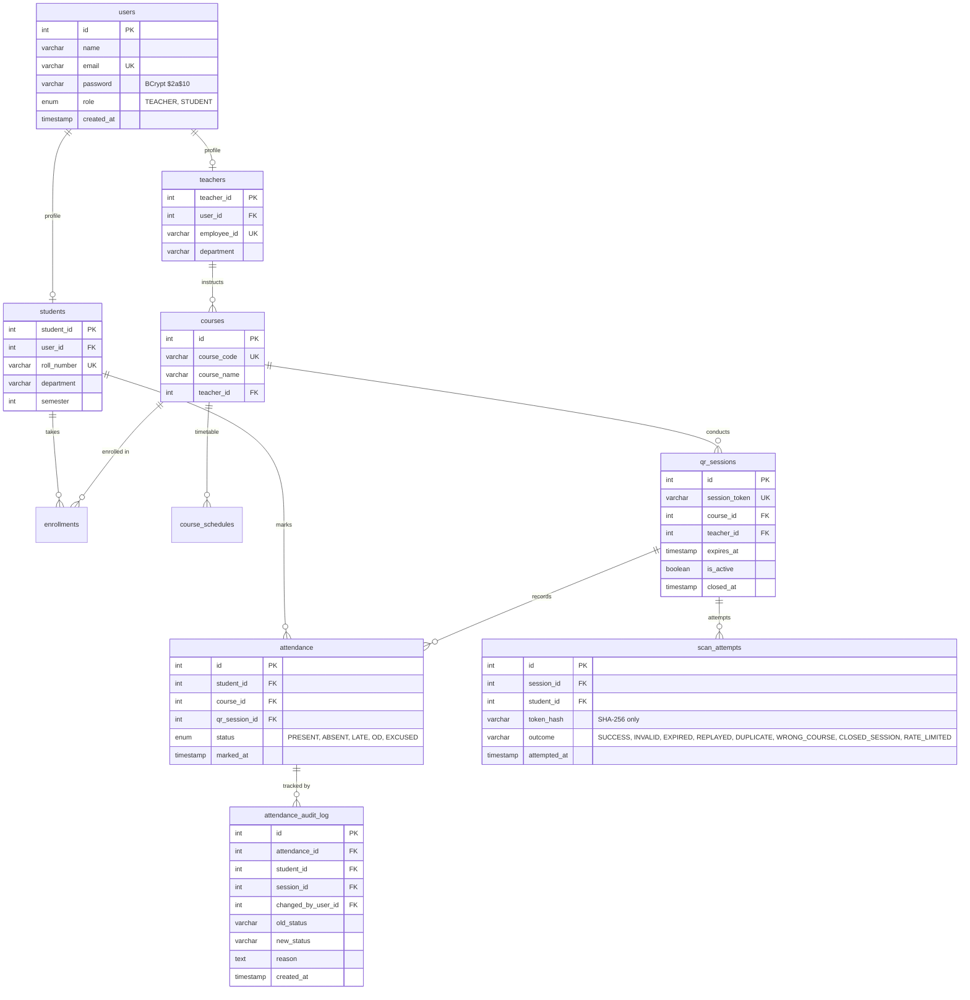

# ⚡ ScanIn — Smart Attendance Marking System
### Dynamic QR Attendance with 5-Second Cryptographic Rotation & Anti-Proxy Architecture

[](https://www.oracle.com/java/)
[](https://tomcat.apache.org/)
[](https://www.mysql.com/)
[]()

---

## 📋 Executive Overview

**ScanIn** is an enterprise-grade, academic attendance management system engineered in **Java 21**, **Jakarta Servlets/JSP**, and **MySQL 8.0**, running on **Apache Tomcat 10.1**.

The system completely eliminates proxy attendance and attendance fraud through:
1. **5-Second Dynamic HMAC-SHA256 QR Tokens:** Cryptographically signed tokens rotate continuously every 5 seconds on the instructor's projector screen.
2. **6-Digit Session-Bound Numeric Fallback Code:** A synchronized 6-digit numeric OTP derived via dynamic truncation for students without functioning cameras, protected by brute-force rate-limiting.
3. **Strict ACID Concurrency Handling:** Multi-thread race conditions during simultaneous student scans are resolved using database constraints and automatic transaction rollbacks.
4. **Immutable Audit Trail:** Any reasoned manual status override (On-Duty `OD`, Medical `EXCUSED`, `PRESENT`, `ABSENT`, `LATE`) is immutably logged with actor ID, timestamp, and justification.
5. **Centralized Role-Based Access Control:** Strict server-side filtering ensures role boundaries (students receive HTTP 403 when probing faculty resources).

---

## 🏛️ Object-Oriented Programming (OOP) Architecture

The application strictly models core domain concepts using Java OOP principles:



### OOP Principles to Code Mapping

| Principle | Concrete Implementation | Source Location |
|---|---|---|
| **Abstraction** | Abstract base class `User` defines template methods `getDashboardPath()` and `getRoleInfo()`, hiding role routing complexity. | [`User.java`](file:///c:/java_dbms_project/src/main/java/com/attendance/model/User.java) |
| **Inheritance** | `Teacher` and `Student` inherit identity attributes (`id`, `name`, `email`, `password`, `phone`) while extending domain-specific fields (`employeeId`, `rollNumber`, `semester`). | [`Teacher.java`](file:///c:/java_dbms_project/src/main/java/com/attendance/model/Teacher.java), [`Student.java`](file:///c:/java_dbms_project/src/main/java/com/attendance/model/Student.java) |
| **Polymorphism** | Runtime dynamic dispatch via `user.getDashboardPath()` and polymorphic contract `student.canMarkAttendance(token)` in scanning pipeline. | [`LoginServlet.java`](file:///c:/java_dbms_project/src/main/java/com/attendance/servlet/LoginServlet.java), [`QrScanServlet.java`](file:///c:/java_dbms_project/src/main/java/com/attendance/servlet/QrScanServlet.java) |
| **Encapsulation** | Strict `private` state across all entities, validated via getters and setters. Password hashes and cryptographic secrets never exposed. | Model package (`com.attendance.model.*`) |
| **Interface Segregation** | Type-safe generic data access contract `Dao<T>` and scanning capability contract `Attendable`. | [`Dao.java`](file:///c:/java_dbms_project/src/main/java/com/attendance/dao/Dao.java), [`Attendable.java`](file:///c:/java_dbms_project/src/main/java/com/attendance/model/Attendable.java) |

---

## 🗄️ Relational Database Schema & Architecture

The database `attendance_db` uses MySQL 8.0 InnoDB storage engine with strict foreign key constraints, unique composite indices, and pooled connections via Tomcat JDBC Pool (`maxActive=20`, `testOnBorrow=true`).



---

## 🛡️ Anti-Proxy & Security Architecture

1. **5-Second Dynamic HMAC-SHA256 Token Rotation:**
   - Server signs payloads containing `sessionId.courseId.timestampMs.nonce` using a constant-time HMAC-SHA256 signature.
   - Tokens expire strictly after 7 seconds (5-second window + 2-second network grace). Expired tokens are immediately rejected as `EXPIRED`.
2. **Replay Attack Neutralization:**
   - As soon as a student marks attendance, the token hash is marked in `scan_attempts`. Subsequent attempts with the same token are rejected as `REPLAYED`.
3. **Session-Bound 6-Digit Numeric Fallback Code:**
   - Derived using TOTP-style dynamic truncation (`computeNumericCode`).
   - Strictly course-bound and session-bound: students cannot use a code for a course they are not enrolled in.
4. **Rapid Guessing & Brute-Force Rate Limiting:**
   - If an account accumulates $\ge 5$ failed scans within a 60-second sliding window, `QrScanServlet` blocks further requests with `RATE_LIMITED`.
5. **ACID Concurrency & Race-Condition Safe:**
   - Database constraint `UNIQUE KEY unique_attendance (student_id, qr_session_id)` prevents concurrent double-marking. Rolled back automatically on code 1062.
6. **Centralized Server-Side RBAC (`SecurityFilter`):**
   - Direct URL tampering (e.g. students trying to access `/reports`, `/qr/generate`, or `/teacher/*`) triggers **HTTP 403 Forbidden**.
7. **BCrypt Password Storage:**
   - All passwords hashed using salted BCrypt (`$2a$10$`). Plaintext storage and hardcoded bypasses completely removed.
8. **Data Minimization:**
   - Raw reusable tokens and IP addresses are never persisted. Only one-way SHA-256 hashes are stored in `scan_attempts`.

---

## 📊 Standardized Attendance Calculation

Implemented uniformly across all database queries, Student Academics Dashboard, and Faculty Course Rosters:

$$\text{Attendance Percentage} = \frac{\text{Attended Sessions (PRESENT + LATE + OD)}}{\text{Total Sessions Conducted} - \text{EXCUSED}} \times 100$$

- **`OD` (On-Duty Approved):** Counted in the attended numerator.
- **`EXCUSED` (Medical / Formal Leave):** Deducted from the total sessions denominator (reducing the denominator burden).
- **Compliance Threshold:** Minimum 75.0%. System displays visual alert badges (`Low Attendance < 75%`) if attendance dips below compliance.

---

## 🚀 Quick Start & Launch

### Prerequisites
- **Java 21 LTS** installed and available on `PATH`.
- **MySQL 8.0** running on `localhost:3306` with credentials `root` / `root`.

### 1-Click Launch
Execute the build and run scripts in Command Prompt or PowerShell:
```bat
.\build.bat
.\run.bat
```
The application will launch on embedded Apache Tomcat 10.1:
👉 **[http://localhost:8080/attendance/login](http://localhost:8080/attendance/login)**

---

## 🔑 Demo Credentials

| Role | Name | Email | Password | Primary Courses |
|---|---|---|---|---|
| **Faculty (Teacher 1)** | Prof. Ramesh Kumar | `teacher@attendance.com` | `teacher123` | CS501 (DBMS), CS502 (OS) |
| **Faculty (Teacher 2)** | Prof. Sunita Sharma | `sunita@attendance.com` | `teacher123` | IT501 (Web Tech) |
| **Student 1** | Aarav Singh | `aarav@student.com` | `student123` | CS501, CS502 |
| **Student 2** | Priya Sharma | `priya@student.com` | `student123` | CS501, CS502 |
| **Student 3** | Rahul Verma | `rahul@student.com` | `student123` | CS501 |

*(The login page features 1-click credential autofill buttons for rapid demonstration.)*

---

## ⏱️ 3–5 Minute Evaluator Presentation & Demo Script

Follow this structured walkthrough when presenting to evaluators or faculty panels:

### Phase 1: Authentication & Role Boundary Isolation (1 Minute)
1. Navigate to `/attendance/login`. Click the **Teacher** autofill pill and sign in as `teacher@attendance.com`.
2. Demonstrate the Faculty Dashboard displaying managed courses (CS501, CS502), enrolled counts, and timetable.
3. Open an Incognito window, log in as `aarav@student.com` (Student).
4. In the student window, attempt to navigate directly to `/attendance/reports` or `/attendance/teacher/dashboard`.
5. **Key Takeaway for Evaluators:** Point out the immediate **HTTP 403 Forbidden** error response enforced by the server-side `SecurityFilter`.

### Phase 2: Dynamic Live QR & Anti-Proxy Rotation (1.5 Minutes)
1. On the Faculty screen, click **"📱 Launch Live QR Session"** for CS501.
2. Observe the dynamic 5-second countdown timer. Show evaluators how the QR code and the **6-digit numeric fallback code** (e.g. `492018`) regenerate synchronously every 5 seconds.
3. On the Student screen, click **"📷 Launch Camera Scanner"**.
4. Type the active 6-digit numeric fallback code and submit.
5. Immediately observe:
   - Student receives confirmation: *"Attendance successfully marked PRESENT!"*
   - Faculty projector counter instantly increments: *"1 student marked"*.
6. Submit the exact same code a second time to show duplicate rejection (*"Attendance was already marked for this session"*).
7. Submit an expired code or rapid random guesses to show rate-limiting protection (*"Rapid guessing blocked. Please wait 1 minute"*).

### Phase 3: Session Reopen, Reasoned Manual Overrides & Audit Trail (1.5 Minutes)
1. On the Faculty screen, click **"⏹ End Session & Mark Absentees"**.
2. Explain to evaluators how absentee reconciliation automatically marks all unmarked enrolled students `ABSENT` in a single atomic query.
3. Navigate to **"📊 Reports & Audit Trail"** (`/attendance/reports?courseId=1`).
4. Click **"✏️ Edit Status"** for an absent student:
   - Select **`OD` (On-Duty)** or **`EXCUSED` (Medical Leave)**.
   - Enter a mandatory audit reason: *"Representing college at Inter-University Coding Hackathon"*.
   - Click **Save with Audit Trail**.
5. Scroll down to the **"🛡️ Immutable Attendance Audit History"** table:
   - Highlight the permanent audit log displaying: Timestamp, Student Name, Faculty Actor (`teacher@attendance.com`), Status Transition (`ABSENT → OD`), and formal Reason.
6. Click **"📥 Download CSV Report"** to export the live audit report directly into an Excel/CSV file.
7. Switch back to Student Dashboard to show the real-time updated Attendance % applying the $(Attended / (Total - Excused))$ formula.

---

## 🧪 Comprehensive Automated Test Evidence

The repository includes complete automated test suites executing live against Tomcat 10 and MySQL 8.0:

```bash
# Execute entire 51-test verification suite
javac -encoding UTF-8 -cp "lib/*;tomcat/lib/*;src/main/webapp/WEB-INF/classes" -d bin src/test/java/com/attendance/*.java
java -cp "bin;lib/*;tomcat/lib/*;src/main/webapp/WEB-INF/classes" com.attendance.Stage8VerificationTest
```

| Verification Suite | Target Areas | Tests | Result |
|---|---|---|---|
| [`Stage2VerificationTest.java`](file:///c:/java_dbms_project/src/test/java/com/attendance/Stage2VerificationTest.java) | Connection Pooling, BCrypt, Schema Constraints, Data Minimization, Concurrency Rollback | 7 / 7 | ✅ PASS |
| [`Stage3VerificationTest.java`](file:///c:/java_dbms_project/src/test/java/com/attendance/Stage3VerificationTest.java) | BCrypt Authentication, Legacy Migration, Unauthenticated Redirection, RBAC 403 Forbidden | 7 / 7 | ✅ PASS |
| [`Stage4VerificationTest.java`](file:///c:/java_dbms_project/src/test/java/com/attendance/Stage4VerificationTest.java) | Student Official Record, Registration Rules, Drop Flow, Timetable, Low Attendance Warning | 7 / 7 | ✅ PASS |
| [`Stage5VerificationTest.java`](file:///c:/java_dbms_project/src/test/java/com/attendance/Stage5VerificationTest.java) | Faculty Course CRUD, Cross-Faculty Edit/Delete Blocking, Roster Authorization, Schedule Validation | 7 / 7 | ✅ PASS |
| [`Stage6VerificationTest.java`](file:///c:/java_dbms_project/src/test/java/com/attendance/Stage6VerificationTest.java) | 5s HMAC Token Rotation, Expired/Replay/Duplicate Rejection, Auto-Close, Concurrent Scans | 10 / 10 | ✅ PASS |
| [`Stage7VerificationTest.java`](file:///c:/java_dbms_project/src/test/java/com/attendance/Stage7VerificationTest.java) | Session Reopen/Reclose, Reasoned Manual Overrides, Immutable Audit Trail, CSV Export, 6-Digit Code | 8 / 8 | ✅ PASS |
| [`Stage8VerificationTest.java`](file:///c:/java_dbms_project/src/test/java/com/attendance/Stage8VerificationTest.java) | Session-Bound 6-Digit Code, Brute-Force Rate Limiting, Formula Uniformity, Full Regression | 5 / 5 | ✅ PASS |
| **Total Automated Tests** | **All Layers & Life-Cycle Flows (7+7+7+7+10+8+5)** | **51 / 51** | **✅ 100% PASS** |

---

## 👥 Authors & Academic Context
- **Project:** ScanIn Smart Attendance Marking System
- **Technologies:** Java 21 LTS, Apache Tomcat 10.1, Jakarta Servlets, MySQL 8.0, JDBC
- **Course / Degree:** Object-Oriented Programming & Database Management Systems Project
